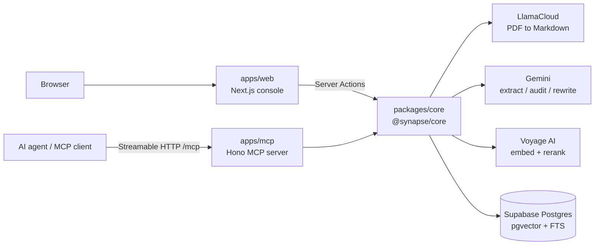
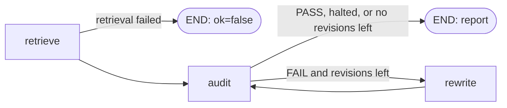

# Synapse

**A brand-governance memory layer for AI content workflows.**

Upload a Brand Bible (PDF) once. Synapse breaks it into atomic, searchable rules and lets any content pipeline **fetch the relevant rules before generating** and **audit drafts after generating** — from a web console or as [MCP](https://modelcontextprotocol.io) tools an AI agent can call directly.

```
Brand Bible (PDF) ──► rule atoms ──► Supabase (pgvector + FTS)
                                          │
              ┌───────────────────────────┴───────────────────────────┐
              ▼                                                       ▼
   synapse-get-context                                     synapse-audit-content
   "what must / must not I do?"                            "does this draft comply?"
   (before generation)                                     (after generation, optional auto-rewrite)
```

## Highlights

- **Atomic rules** — each extracted rule is one enforceable requirement with a category, context (platform), polarity (requirement / prohibition) and a verbatim source quote.
- **Hybrid retrieval** — vector search + full-text search fused with Reciprocal Rank Fusion in Postgres, then reranked with Voyage.
- **Prohibitions are never missed** — every prohibition and every `Global` rule is pulled into the candidate pool, so a banned-word list can't be lost because the draft isn't semantically close to it.
- **Verbatim directives** — `get-context` returns the stored rules as-is, split into `MUST FOLLOW` / `MUST NOT`. No LLM paraphrase of a legal rule, and latency stays at embed + search + rerank.
- **Status can't contradict score** — the LLM returns a score and violations; `PASS`/`FAIL` is derived in code (`score >= 80`).
- **Audit → rewrite → re-audit loop** — optionally rewrites a failing draft and re-audits it (up to 3 revisions).
- **Fails loudly** — an outage is never reported as "no rules apply". Every retrieval/audit/context call returns an explicit `ok: false` with a typed reason.
- **Prompt-injection fencing** — draft content is treated as untrusted data inside `<proposed_content>` tags; fence tags are stripped from user text before it reaches a prompt.

## Architecture



Turborepo + pnpm monorepo:

```
synapse/
├── apps/
│   ├── web/    Next.js 16 console — ingest, audit, clear memory
│   └── mcp/    Hono MCP server — synapse-get-context, synapse-audit-content
└── packages/
    └── core/   @synapse/core — parse, ingest, retrieve, context, audit, memory
```

| Layer     | Stack                                                                              |
| --------- | ---------------------------------------------------------------------------------- |
| Web       | Next.js 16 (React 19, React Compiler, Server Actions), Tailwind v4, Radix / shadcn |
| MCP       | Hono, `@hono/mcp` `StreamableHTTPTransport`, `@modelcontextprotocol/sdk`           |
| Core      | TypeScript (ESM), Vercel AI SDK, LangGraph, LangChain text splitters, Zod          |
| Providers | LlamaCloud (parsing), Google Gemini (LLM), Voyage AI (embeddings + rerank)         |
| Storage   | Supabase Postgres with `pgvector` (HNSW) and `tsvector` (GIN)                      |

## How it works

### 1. Ingest — `ingestBrandBible(buffer, fileName)`

1. **Parse** — the PDF is uploaded to LlamaCloud (agentic tier, custom prompt that recovers tables and describes diagrams) and polled every 3 s, with a 3-minute timeout, until Markdown comes back.
2. **Chunk** — Markdown-aware splitting (headers first, then paragraphs) into ~8,000-character chunks.
3. **Extract** — Gemini extracts rule atoms from each chunk (3 chunks in parallel) using a strict schema: `category`, `rule`, `context`, `is_negative`, `source_quote`. Extraction is **all-or-nothing**: one failed chunk fails the ingest instead of silently dropping rules.
4. **Dedupe** — identical rules (same polarity + context + normalized text) are stored once.
5. **Embed** — each atom is embedded as `[Type: REQUIREMENT|PROHIBITION] [Category: …] [Context: …] Rule: …` (batches of 30). Putting the type in the text means the reranker and audit LLM can see prohibitions.
6. **Store** — rows are inserted in batches of 50. If any batch fails, rows already inserted are **rolled back**.

Failures return `{ success: false, stage, error, code? }` — stages: `PARSER_FAILURE`, `EXTRACTION_FAILURE`, `NO_RULES_FOUND`, `EMBEDDING_FAILURE`, `EMBEDDING_MISMATCH`, `DATABASE_WRITE_FAILURE`.

### 2. Retrieve — `retrieveAtoms(query)` (internal)

```
embed(query) ─┬─► match_hybrid_synapse RPC (vector + FTS, RRF k=60, top 20) ─┐
              └─► pinned rules (is_negative = true OR context = "Global", ≤30) ┴─► merge + dedupe ─► rerank
                                                                                                        │
                                              top 10 by relevance + up to 5 pinned rules ranked lower ◄─┘
```

- If the reranker fails, retrieval falls back to hybrid order instead of failing.
- If the pinned-rule query fails, retrieval degrades to similarity-only.
- Embedding or RPC failure → `{ ok: false, reason }`. An empty store → `NO_BRAND_MEMORY_STORED`.

### 3. Context — `getContext(prompt)`

Retrieves atoms and formats them deterministically:

```
### SYNAPSE BRAND GOVERNANCE DIRECTIVE ###
You are generating content on behalf of the brand. Follow these rules exactly.

MUST FOLLOW:
  ✓ [Type: REQUIREMENT] [Category: Tone] [Context: Instagram] Rule: Use a friendly, conversational voice.

MUST NOT:
  ✗ [Type: PROHIBITION] [Category: Restriction] [Context: Global] Rule: Do not use the word "cheap".

Do not reference these rules directly in your final output unless explicitly asked.
```

An empty memory store is a _successful_ lookup (`hasContext: false`). A provider or database failure is `ok: false` — never confused with "no constraints".

### 4. Audit — `runAudit(content, { maxRevisions })`



- The audit LLM sees only the retrieved rules (as `<rule id="…">`) and must cite a `rule_id` for every violation. Cited IDs are resolved back to the rule text.
- **Scoring:** `100` = perfect, `80–99` = `PASS` with minor tone adjustments, `0–79` = `FAIL`. Status is computed in code from the score.
- `maxRevisions` is clamped to `0–3` (default `0` = audit only). With `N` revisions, up to `N + 1` audits run.
- If a rewrite or re-audit fails mid-loop, the last good report is kept and the loop halts.
- `revisedContent` is returned only when the audited draft differs from the input.

## MCP server

Served over Streamable HTTP at **`http://localhost:7000/mcp`** (stateless — a fresh MCP server instance per request).

### `synapse-get-context`

Call **before** generating content.

|                         |                                                              |
| ----------------------- | ------------------------------------------------------------ |
| **Input**               | `prompt: string` — the brief, prompt, or topic               |
| **Output (text)**       | the formatted directive above                                |
| **Output (structured)** | `has_context: boolean`, `rules: { id, rule, is_negative }[]` |
| **On failure**          | `isError: true` — "Do NOT assume that no brand rules apply." |

### `synapse-audit-content`

Call **after** drafting.

|                         |                                                                                                                                              |
| ----------------------- | -------------------------------------------------------------------------------------------------------------------------------------------- |
| **Input**               | `content: string`, `max_revisions?: 0–3` (default `0`)                                                                                       |
| **Output (text)**       | human-readable audit report                                                                                                                  |
| **Output (structured)** | `status: "PASS" \| "FAIL"`, `score`, `feedback`, `violations: { rule_id, rule?, reason, suggested_fix }[]`, `revised_content?`, `audits_run` |
| **On failure**          | `isError: true` — "The content was NOT audited."                                                                                             |

Both tools are annotated `readOnlyHint: true`.

**Connect a client** (example with Claude Code):

```bash
claude mcp add --transport http synapse http://localhost:7000/mcp
```

Or inspect it interactively: `pnpm --filter @synapse/mcp inspector` → transport **Streamable HTTP** → `http://localhost:7000/mcp`.

## Web console

`http://localhost:3000` — a single-page console:

1. **Memory Ingestion** — upload a Brand Bible PDF, see how many rules are active, clear memory (with a confirmation modal). Ingestion is blocked while memory exists; clear first to load a new Brand Bible.
2. **Execution Testbench** — paste draft copy and run an audit (locked until memory exists).
3. **Audit Feedback** — score, `PASS`/`FAIL`, summary, and per-rule violations with reasons and suggested fixes. The console runs audit-only (no auto-rewrite).

## Getting started

### Prerequisites

- **Node.js 24+** (`.nvmrc` pins 24)
- **pnpm** — pinned via `packageManager` (run `corepack enable`)
- A **Supabase** project
- API keys for **Voyage AI**, **Google AI (Gemini)**, and **LlamaCloud**

### Setup

```bash
pnpm install

cp apps/web/.env.example apps/web/.env
cp apps/mcp/.env.example apps/mcp/.env
# fill in both files (see Environment variables)

# run the SQL from "Database setup" in the Supabase SQL editor, then:
pnpm dev
```

`pnpm dev` builds `@synapse/core`, then starts core in watch mode plus both apps via Turborepo.

| Service     | URL                       |
| ----------- | ------------------------- |
| Web console | http://localhost:3000     |
| MCP server  | http://localhost:7000/mcp |

### Production

```bash
pnpm build
pnpm --filter @synapse/mcp start    # node dist/main.js
pnpm --filter @synapse/web start    # next start
```

## Environment variables

Both `apps/web` and `apps/mcp` need these (the shared core reads them at startup). See each app's `.env.example`.

| Variable                       | Required | Description                                             |
| ------------------------------ | :------: | ------------------------------------------------------- |
| `SUPABASE_URL`                 |    ✅    | Supabase project URL                                    |
| `SUPABASE_SERVICE_ROLE_KEY`    |    ✅    | Service-role key (bypasses RLS — keep server-side)      |
| `VOYAGE_API_KEY`               |    ✅    | Embeddings + reranking                                  |
| `GOOGLE_GENERATIVE_AI_API_KEY` |    ✅    | Gemini: rule extraction, audit, rewrite                 |
| `LLAMA_CLOUD_API_KEY`          |    ✅    | PDF parsing                                             |
| `GEMINI_EXTRACTION_MODEL`      |          | Default `gemini-3.5-flash`                              |
| `GEMINI_AUDIT_MODEL`           |          | Default `gemini-3.5-flash` (used for audit and rewrite) |
| `VOYAGE_EMBEDDING_MODEL`       |          | Default `voyage-4-lite`                                 |
| `VOYAGE_RERANKING_MODEL`       |          | Default `rerank-2.5-lite`                               |
| `PORT`                         |          | Web defaults to `3000`, MCP to `7000`                   |

> The table name is fixed to `synapse_memory` in `packages/core/src/lib/supabase.ts`.

## Database setup

Run once in the Supabase SQL editor. This creates the table, indexes, and the hybrid-search RPC that retrieval calls.

> The `vector(1024)` size must match your embedding model's output. It fits the default `voyage-4-lite`; if you override `VOYAGE_EMBEDDING_MODEL` with a model of a different dimension, change it in both the table and the RPC.

```sql
---------------------------------------------------------
-- 0. Extension
---------------------------------------------------------
create extension if not exists vector;

---------------------------------------------------------
-- 1. Table: synapse_memory
---------------------------------------------------------
create table if not exists synapse_memory (
  id          uuid primary key default gen_random_uuid(),
  content     text not null,
  embedding   vector(1024) not null,
  metadata    jsonb not null default '{}'::jsonb,
  fts_content tsvector generated always as (to_tsvector('english', content)) stored,
  created_at  timestamptz not null default now(),
  updated_at  timestamptz not null default now()
);

create or replace function set_updated_at()
returns trigger as $$
begin
  new.updated_at = now();
  return new;
end;
$$ language plpgsql;

drop trigger if exists trg_synapse_memory_updated_at on synapse_memory;
create trigger trg_synapse_memory_updated_at
  before update on synapse_memory
  for each row
  execute function set_updated_at();

---------------------------------------------------------
-- 2. Indexes
---------------------------------------------------------
-- Approximate nearest-neighbour search (cosine, matches Voyage)
create index if not exists idx_synapse_memory_embedding_hnsw
  on synapse_memory
  using hnsw (embedding vector_cosine_ops)
  with (m = 16, ef_construction = 64);

-- Full-text search
create index if not exists idx_synapse_memory_fts_gin
  on synapse_memory
  using gin (fts_content);

-- Optional: speeds up the RPC's `filter` (metadata @> filter) argument
create index if not exists idx_synapse_memory_metadata_gin
  on synapse_memory
  using gin (metadata jsonb_path_ops);

---------------------------------------------------------
-- 3. RPC: match_hybrid_synapse — vector + keyword search fused with RRF
---------------------------------------------------------
create or replace function match_hybrid_synapse (
  query_text      text,
  query_embedding vector(1024),
  match_count     int default 10,
  filter          jsonb default '{}'::jsonb,
  rrf_k           int default 60
)
returns table (id uuid, content text, metadata jsonb, hybrid_score float)
language plpgsql
stable
as $$
begin
  return query
  with q as (
    -- OR-style keyword query so long drafts still match on any term
    select nullif(
      replace(plainto_tsquery('english', query_text)::text, ' & ', ' | '),
      ''
    )::tsquery as tsq
  ),
  semantic as (
    select
      sm.id,
      row_number() over (order by sm.embedding <=> query_embedding) as rank
    from synapse_memory sm
    where (filter = '{}'::jsonb or sm.metadata @> filter)
    order by sm.embedding <=> query_embedding
    limit match_count * 2
  ),
  keyword as (
    select
      sm.id,
      row_number() over (order by ts_rank_cd(sm.fts_content, q.tsq) desc) as rank
    from synapse_memory sm, q
    where q.tsq is not null
      and sm.fts_content @@ q.tsq
      and (filter = '{}'::jsonb or sm.metadata @> filter)
    order by ts_rank_cd(sm.fts_content, q.tsq) desc
    limit match_count * 2
  ),
  fused as (
    select
      coalesce(s.id, k.id) as id,
      (coalesce(1.0 / (rrf_k + s.rank), 0.0) + coalesce(1.0 / (rrf_k + k.rank), 0.0))::double precision as score
    from semantic s
    full outer join keyword k on s.id = k.id
  )
  select sm.id, sm.content, sm.metadata, fused.score as hybrid_score
  from fused
  join synapse_memory sm on sm.id = fused.id
  order by fused.score desc
  limit match_count;
end;
$$;
```

Each row's `metadata` holds `category`, `rule`, `context`, `is_negative`, `source_quote`, `chunk_index`, `source_file`, and `ingested_at`.

## Using `@synapse/core` directly

The core package is private to the monorepo and exposes sub-path exports:

```ts
import { ingestBrandBible } from "@synapse/core/ingest";
import { getContext } from "@synapse/core/context";
import { runAudit } from "@synapse/core/audit";
import { getMemoryStatusCore, clearMemoryCore } from "@synapse/core/memory";

// Before generation
const ctx = await getContext("Write an Instagram caption for our spring sale");
if (!ctx.ok) throw new Error(`${ctx.reason}: ${ctx.message}`); // don't proceed as if no rules apply
const systemPrompt = ctx.systemDirective;

// After generation
const outcome = await runAudit(draft, { maxRevisions: 2 });
if (outcome.ok) {
  console.log(outcome.report.status, outcome.report.score);
  console.log(outcome.revisedContent ?? draft);
}
```

Result types: `ContextOutcome`, `AuditOutcome` (`ok: true` carries `report`, `revisedContent`, `atoms`, `metadata`; `ok: false` carries `reason` + `message`), `IngestResult`, `MemoryStatus`.

Failure reasons: `EMBEDDING_PROVIDER_ERROR`, `DATABASE_RPC_ERROR`, `NO_BRAND_MEMORY_STORED` (audit only — `getContext` treats it as success), `LLM_PROVIDER_ERROR` (audit only).

## Scripts

| Command                                | What it does                         |
| -------------------------------------- | ------------------------------------ |
| `pnpm dev`                             | Core in watch mode + web + MCP       |
| `pnpm build`                           | Build everything (core builds first) |
| `pnpm typecheck`                       | `tsc --noEmit` across the workspace  |
| `pnpm --filter @synapse/mcp inspector` | Open the MCP Inspector               |

## Tuning

Constants you may want to adjust (all in `packages/core/src`):

| Constant                                  | File                    | Default       |
| ----------------------------------------- | ----------------------- | ------------- |
| `AUDIT_PASS_THRESHOLD`                    | `types/audit.type.ts`   | `80`          |
| `MAX_REVISIONS_CAP`                       | `services/audit.ts`     | `3`           |
| `HYBRID_MATCH_COUNT` / `RRF_K`            | `services/retrieval.ts` | `20` / `60`   |
| `RERANK_TOP_N`                            | `services/retrieval.ts` | `10`          |
| `PINNED_FETCH_LIMIT` / `PINNED_MAX_EXTRA` | `services/retrieval.ts` | `30` / `5`    |
| `CHUNK_SIZE_CHARS`                        | `services/ingest.ts`    | `8000`        |
| `EXTRACTION_CONCURRENCY`                  | `services/ingest.ts`    | `3`           |
| `EMBED_BATCH_SIZE` / `DB_BATCH_SIZE`      | `services/ingest.ts`    | `30` / `50`   |
| `MAX_POLL_RETRIES` / `POLL_INTERVAL_MS`   | `services/parser.ts`    | `60` / `3000` |

## Security & limitations

Scoped as a single-tenant reference implementation. Known gaps and the intended fix:

| Area                | Current state                                      | Production path                                                                                |
| ------------------- | -------------------------------------------------- | ---------------------------------------------------------------------------------------------- |
| Auth                | MCP endpoint and web console are unauthenticated   | API key or OAuth on `/mcp`; session auth on the console                                        |
| Destructive actions | "Clear Context" deletes all rules                  | Role check + audit log                                                                         |
| Tenancy             | One Brand Bible per deployment                     | Add a `brand_id` column and filter in the RPC (the `metadata @>` filter already supports this) |
| Secrets             | Service-role key, server-side only                 | Per-tenant RLS + anon key                                                                      |
| Judgement           | Scores come from an LLM bounded by retrieved rules | Human review for high-risk content                                                             |
